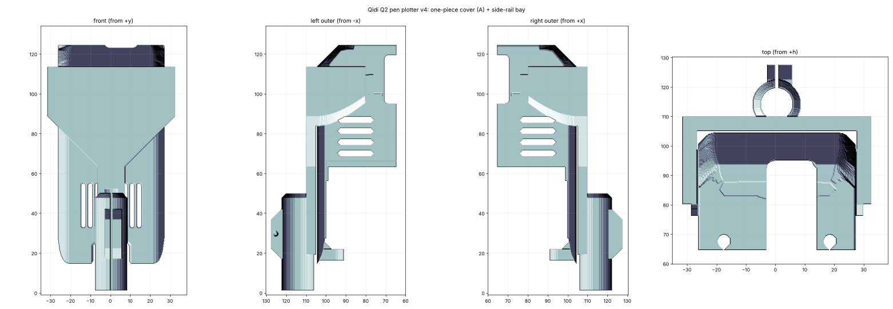
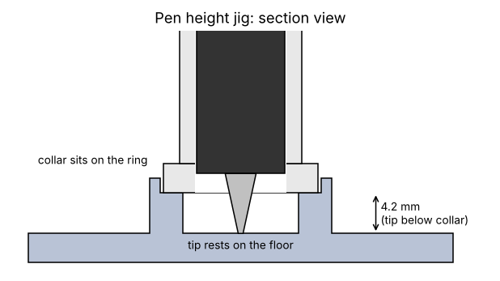

# Hardware

All files are in `stl/` (print-ready) and `step/` (for editing). Version 4.

| File | Print | Notes |
| --- | --- | --- |
| `qs_cover_v4_A_FRONT_DOWN_print.stl` | Cover, variant A | Front face down, no supports |
| `qs_cover_v4_B_FRONT_DOWN_print.stl` | Cover, variant B | Front face down, no supports |
| `qs_pen_bay_v4_print.stl` | Pen bay | Already flipped, flat crossbar on the bed |
| `qs_pen_cartridge_v4_bore9.0.stl` | Pen cartridge | Print upright. Pick the bore that fits your pen: 9.0, 9.5 or 10.0 |
| `qs_pen_cartridge_v4_bore9.5.stl` | | |
| `qs_pen_cartridge_v4_bore10.0.stl` | | |
| `qs_pen_height_jig_v1_tip3.2/4.2/5.2.stl` | Pen height jig | Sets how far the pen tip sticks out below the cartridge collar, so you don't need `PEN_TOUCH` after every pen change. Pick the number that matches your tip height (4.2 mm is what I use) |
| `qs_bay_wedge_clip_v1_end7.7/7.9/8.1.stl` | Screwless clamp | A wedge clip that slides onto the bay's two clamp ears and squeezes them shut instead of the M2 screw. See below |
| `qs_cutter_sleeve_v1_bore10.5/11.0/11.5.stl` | Cutter sleeve | Experimental, see [../docs/CUTTER.md](../docs/CUTTER.md) |

Print one cover, variant A or B (TODO: describe the difference between them).

STEP files: the cover, in print orientation and in model orientation.

## You will also need

- M2x8 screw, one (bay clamp). M2x6, M2x8 and M2x20 are the only sizes I used.
- 4 magnets, 5 x 2 mm.
- CA glue.

## Assembly

1. Fit the cover on the toolhead. For the magnets: stick each 5 x 2 mm magnet onto the duct-wing magnet (right polarity), lower the cover over them, then drip CA glue into the slot.
2. Slide the bay onto the two side rails from the **front**, toward the back, until the crossbar touches the cover face. The fit is tapered, so it is snug at the end.
3. Drop the cartridge with the pen in from the top and nip the M2x8 clamp screw.

The bay bore is 12.8 mm and the cartridge outside diameter is 12.6 mm, with a slit so the clamp screw can squeeze it onto the pen.

## Pen height jig

1. Put the jig on a flat table, ring side up.
2. With the bay screw loose, stand the bay and cartridge on the jig so the cartridge collar sits on the ring.
3. Drop the pen in from the top until the tip rests on the floor.
4. Tighten the M2x8 clamp screw. The tip now sticks out exactly the same amount every time.

The three files differ only in how far the tip sticks out below the collar: 3.2, 4.2 or 5.2 mm. Use the same one every time, and keep the `z_draw` you found with it.

## Screwless wedge clip

The 7.9 version has been tested on a real Q2 and holds the cartridge well. The 7.7 and 8.1 versions are untested spares for printers that run a little tight or loose.

The bay's clamp ears are 8.8 mm thick with the slit open and 8.0 mm with it closed. The clip is a U with a tapered inside: it is 9.1 mm wide at the mouth, narrowing to 7.7, 7.9 or 8.1 mm (the number in the file name) at the bridge.

1. Set the cartridge height with the jig and leave the M2 screw out.
2. Slide the clip onto the ears from the top, bridge end first, with the thumb tab facing out, and push it until it stops.
3. The taper squeezes the slit shut. The slope is shallow enough (about 6 degrees on each side) that friction keeps it locked.

Print it upright (the U standing on its mouth) in PETG or ABS, 100% infill, 4 perimeters. Try the 7.9 first. If it will not go on, use 8.1. If it goes on but is loose, use 7.7.
