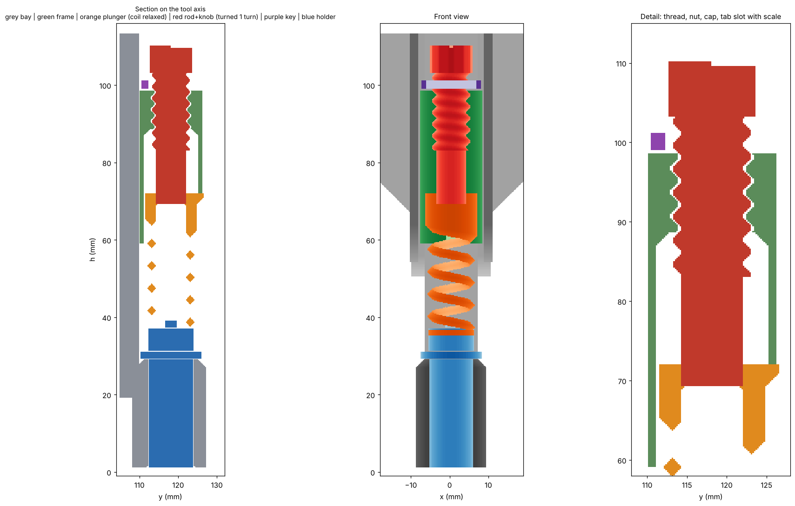

# GCC blade holder: cutter bay + adjustable pusher (v2, untested)

Nothing here has been printed or cut yet. It was checked only by a voxel fit test against the holder dimensions you measured.

## How it works

A GCC-style holder hangs by its flange and a spring presses its top pin. The pin force minus the holder's own internal spring is the cutting force, and the blade backs off if the surface rises. A **thumbwheel** compresses the printed coil further, so you dial the force by hand. The holder's 165 gf at full travel does not add to the force, it opposes the coil.

## Parts (print list)

| File | Qty | Notes |
| --- | --- | --- |
| `qs_cutter_bay_v2.stl` | 1 | Same bracket, spine, dovetails, flanges and wings as pen bay v5, print bracket down, no supports. Tube axis is 3.0 mm further forward (y 118.2, was 115.2). Two key pockets in the flange walls. |
| `qs_cutter_adj_frame_v2.stl` | 1 | Tongue, guide tube and a printed nut. Print with the tube bottom on the bed, no supports. |
| `qs_cutter_adj_plunger_v2.stl` | 1 | Pusher disc, coil, cap and a tab that shows the setting. Print disc down, no supports. |
| `qs_cutter_adj_rod_knob_v2.stl` | 1 | Threaded rod and thumb knob. Print with the knob on the bed. |
| `qs_cutter_key_v2.stl` | 1 | Slides in from the front through the flange pockets and holds the frame down. |
| `qs_cutter_pusher_v2_soft/std/firm/hard.stl` | optional | Fixed-force modules with no thumbwheel (coil 24, 33, 58, 103 gf/mm). They use the same bay and key. |

Thread: 3 mm pitch, right hand, 0.3 mm radial clearance. Print the rod and frame with 0.2 mm layers, 100% infill for the rod.

## Assembly order

1. Drop the holder into the bay tube (flange on the seat ring).
2. Drop the plunger into the frame from below and the frame onto the bay's channel, so the disc lands on the pin. Press the frame down until the key pockets show at the top.
3. Slide the key in from the front through both flange pockets, above the frame.
4. Screw the rod in from the top, last. Turn **clockwise** to raise the force. The tab and ticks on the front of the tube show the setting.

To remove it, unscrew the rod, pull the key, lift the frame and plunger out. The rod has to come out first because the key slides past it.

## Force setting (coil about 32 gf/mm, estimated, plus or minus 40%)

Cut force in gf at pin depression x (blade out is about 0.875 x), for rod travel from the zero mark:

| Rod travel | Turns | x = 5 | x = 4.6 (about 4 mm blade) | x = 4 | x = 3 |
| --- | --- | --- | --- | --- | --- |
| 0 mm | 0 | 51 | 72 | 102 | 153 |
| 3 mm | 1 | 146 | 167 | 197 | 248 |
| 6 mm | 2 | 241 | 262 | 292 | 344 |
| 7 mm (max) | 2.3 | 273 | 294 | 324 | 375 |

One turn adds about 95 gf. Do not combine the maximum travel with x below about 3.4 mm, because the coil goes solid.

Without the coil rate known better, **calibrate with your scale**: record the force at several knob settings and use that table in the app.

## Assumptions (check these)

- Flange 2.0 mm thick.
- Barrel 28.2 mm from the flange underside to the nose end (A 30.2 minus the flange).
- Ring 6.0 mm tall above the flange, pin 8 mm above the ring.
- Internal spring 10 gf at touch and 165 gf at 8 mm (your measurement, treated as linear).
- Printed PETG shear modulus about 500 MPa.
- Nothing above the bay's top face (h 113.5): the knob reaches 113.4.

Change `params.py` and rerun `python3 cutter_bay.py; python3 cutter_adjust.py; python3 fit_adj.py` if any dimension is off.

## Consequences

- The tool axis moves 3.0 mm in model y compared with the pen bay, so the cutter needs its own XY offset.
- The blade is always exposed (about 5 mm free-hanging). Lift Z before travelling near the purge bin, and run homing and bed mesh with the cutter off.
- The nose is flush with the bottom of the tube, so Z touch needs its own calibration.
- The earlier notch-and-finger retention in v1 could not hold the coil's push, so it was replaced by the key.

## v3: true-CAD STEP files (`v3_step/`)

Every cutter part is rebuilt as a parametric B-rep (OpenCascade via build123d), so circles are real cylinders and cones, and the springs and threads are real helical sweeps, not triangle meshes. Each part is one valid solid. Files ending `_model_orientation.step` are in the printer frame; `_print.step` and `print_stl/*.stl` are laid out for printing (bay and rod flipped, the rest unchanged). Regenerate with `scripts/export_all.py` (needs `pip install build123d`).

| Part | Print orientation | Notes |
|---|---|---|
| `qs_cutter_bay_v3` | bracket down | flanges now use the full intended profile (see changes) |
| `qs_cutter_adj_frame_v3` | tube bottom on bed | |
| `qs_cutter_adj_plunger_v3` | disc down | |
| `qs_cutter_adj_rod_knob_v3` | knob down, 100% infill | |
| `qs_cutter_key_v3` | flat | |
| `qs_cutter_pusher_v3_soft/std/firm/hard` | disc down | fixed-force alternatives |

**Print tolerances built in (all radial or per side):** holder bore 0.175, nut thread 0.3 (axial and radial), plunger cap to tube 0.3, plunger disc 1.1, plunger tab to slot 0.3, key to pocket 0.3 sideways and 0.15 to 0.25 in height, tab to slot ceiling 0.4. Every overhang is 45 degrees or steeper: coil diamond faces (46 degrees or 45), thread flanks (45), conical roofs inside the cap and arm, cone under the nut, tab underside. The coil's helical land underside follows the coil slope, so nothing needs a bridge or support.

**Changes from v2:**
- Bay flanges: v2's voxel model trimmed them to y 110.6 because a non-convex profile was treated as convex. v3 uses the intended profile (to y 112.5), which is what the key pockets need. Check the key slides in before relying on it.
- Slot ceiling above the plunger tab raised 0.4 mm (it was zero clearance).
- Coil tips get 0.15 mm flats (0.3 mm tall) because a razor tip does not print. Stiffness changes by under 1%.
- Not changed: all dimensions, thread, force table, assembly order.

**Checked in CAD (boolean interference, 0 mm3 everywhere):** holder in bay; frame, key and plunger against the bay; plunger and rod against the frame through 0 to 7 mm preload, with the rod screwed down along the thread; rod 0.15 mm off-centre in the nut. Compared with v2's voxel parts: 98.5 to 99.2% overlap, the remainder being surface quantisation, except the bay flange change above.
