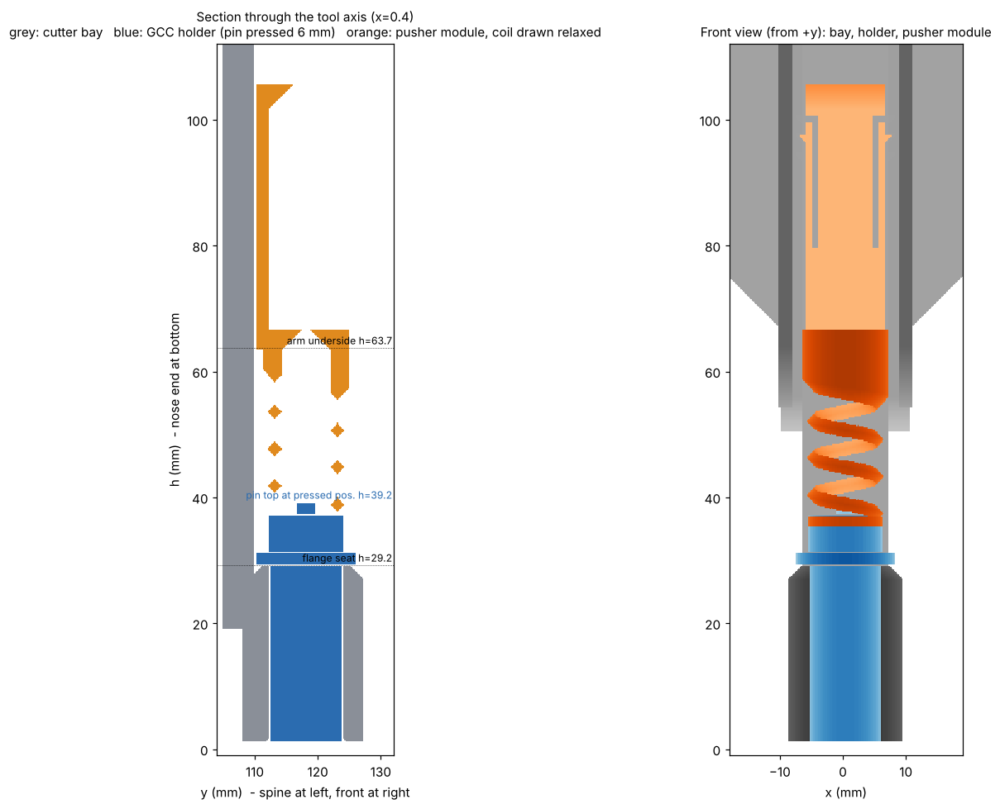

# GCC blade holder: cutter bay + pusher module (v1, untested)

Nothing here has been printed or cut yet. It was checked only by a voxel fit test against your measured holder dimensions.

## What it is

A GCC-style holder hangs by its flange, and a spring presses its top pin. The pin force minus the holder's own internal spring is the cutting force, and the blade backs off when the surface rises. That is the same idea as the Bambu cutter, with a printed coil as the spring.

| Part | File | Notes |
| --- | --- | --- |
| Cutter bay | `qs_cutter_bay_v1.stl` | Same bracket, spine, dovetails, flanges and wings as pen bay v5. Print the same way (bracket down, no supports). The tube is 3.0 mm further forward (axis y 118.2, was 115.2) so the 15.75 mm flange clears the spine plate. |
| Pusher module | `qs_cutter_pusher_v1_soft/std/firm/hard.stl` | One part: tongue, arm, coil, pusher disc. Print upright with the disc on the bed, no supports. |

Coil variants (estimated from beam theory, printed PETG, **plus or minus 40%**):

| Variant | Coil rate | Total stiffness at the blade | Cut force at pin depression 4.6 mm (blade out about 4 mm) |
| --- | --- | --- | --- |
| soft | 24 gf/mm | 44 gf/mm | about 60 gf |
| std | 33 gf/mm | 52 gf/mm | about 73 gf |
| firm | 58 gf/mm | 78 gf/mm | about 110 gf |
| hard | 103 gf/mm | 122 gf/mm | about 295 gf (above 165 gf from blade out about 5 mm) |

Cut force (gf) against pin depression x (blade out is about 0.875 x):

| x (mm) | 5 | 4 | 3 | 2 | 1 | 0 |
| --- | --- | --- | --- | --- | --- | --- |
| soft | 44 | 88 | 131 | 175 | 219 | 263 |
| std | 52 | 104 | 156 | 208 | 260 | 312 |
| firm | 78 | 155 | 233 | 310 | 388 | 466 |
| hard | 245 | 368 | 490 | 613 | 736 | 858 |

Free-hanging (no contact) soft, std and firm sit at x = 6.0 (hard at 7.0), which is about 5 mm of blade. Lowering the carriage after touching the mat raises the force by the total stiffness per mm, so a 0.1 mm Z error is about 5 gf (std). The force is set by Z, so calibrate it with your kitchen scale.

## Fit

1. Drop the holder in from the top. The flange sits on the tube's seat ring (bore 11.9 mm for your 11.55 mm barrel).
2. Drop the pusher module in from the top between the two flanges. It clicks into one of three notches (3 mm apart), and the coil pushes the disc onto the pin. The notch row is your coarse blade-exposure adjustment.
3. To change the holder, lift the module out first (grip shelf at the top).

Voxel checks (`fitcheck.py`): no overlap between holder and bay, holder and module, or module and bay in the installed pose. The holder and the module both drop in from above without touching the bay (the detent bumps flex 0.5 mm).

## Assumptions (check these)

- Flange 2.0 mm thick.
- Barrel 28.2 mm from the flange underside to the nose end (A 30.2 minus the flange).
- Ring 6.0 mm tall above the flange, pin 8 mm above the ring, so the pin top at rest is 16 mm above the flange.
- Internal spring 10 gf at touch and 165 gf at 8 mm (your measurement, treated as linear).
- Printed PETG shear modulus about 500 MPa.

If any dimension is off, change `params.py` and rerun: `python3 cutter_bay.py; python3 cutter_pusher.py std; python3 fitcheck.py`. The module's arm height follows from the pin height automatically.

## Consequences

- The tool axis moves 3.0 mm in model y compared with the pen bay, so the cutter needs its own XY offset.
- The blade is always exposed (about 5 mm free-hanging). Lift Z before travelling near the purge bin, and run homing and bed mesh with the cutter off.
- The nose is flush with the bottom of the tube, so Z touch needs its own calibration.
